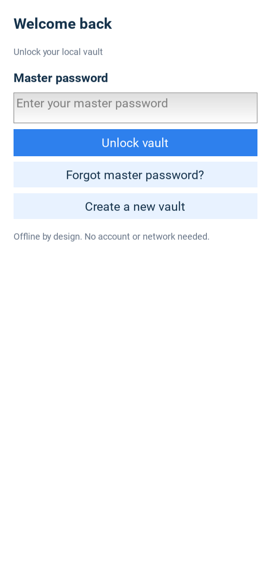
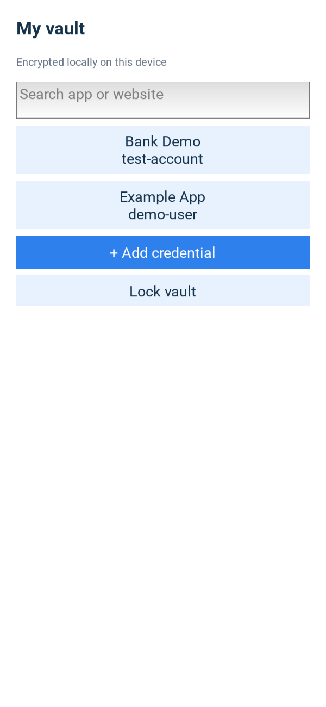

# Lockbox Password Manager

Lockbox is a Python/Kivy Android capstone prototype for one user and one local
vault. It stores encrypted credentials on the phone, generates passwords, and
locks after two minutes of inactivity. No server or online Lockbox account is
required.

**Prototype status:** core workflows are implemented and user-tested on a
Samsung Galaxy S25+ running Android 17. This is not an independently audited
production password manager. Use synthetic credentials for evaluation and read
the [known limitations](docs/release/known-limitations.md).

## Download and install

[Download the Android test APK](https://github.com/xominnow/password-manager/releases/download/v0.1.0/lockbox-0.1.0-arm64-v8a_armeabi-v7a-debug.apk)
or open the [snapshot release page](https://github.com/xominnow/password-manager/releases/tag/v0.1.0).

Requires Android 8.0/API 26 or newer and a supported ARM64/ARMv7 device.
Compatibility with every Android phone has not been established.

1. Download the `.apk` under release Assets, not the source-code ZIP.
2. Open it on the phone, approve installation from that source if prompted,
   and open Lockbox. You can transfer the APK from a different computer.
3. Create a master password, save the recovery key privately, and sign in.

Users do not need Python, WSL or Buildozer to install the APK. Each fresh
installation creates an independent vault. There is no synchronization,
backup/export or device transfer. Uninstalling or clearing app data can
permanently delete the vault; a recovery key cannot restore deleted data.

The `v0.1.0` snapshot is a **debug test build**, separate from the unchanged
historical `Lockbox_V0.1.0` release. Its source/package checks and SHA-256 are
recorded in the [snapshot record](docs/release/final-source-snapshot.md).
The rebuilt snapshot APK still needs a fresh phone smoke test; earlier phone
results do not establish this artifact's installed behavior. See the
[deployment guide](docs/release/installation-and-deployment.md) for updates.

## Implemented features

- Master-password setup/login with an eight-character minimum and uppercase,
  lowercase, number and punctuation requirements.
- Independent recovery-key reset preserving existing entries. New recovery
  keys contain 16 case-sensitive alphanumeric characters; legacy keys remain supported.
- Local encrypted credential creation, viewing, editing and confirmed deletion.
- Case-insensitive app/website-name search, password generation and strength feedback.
- Masked-by-default detail view, explicit reveal/copy and best-effort clipboard expiry.
- Manual lock, two-minute inactivity lock, sensitive-screen cleanup and Android
  screenshot/recording protection.
- Scrollable forms and text/control wrapping for keyboard and enlarged-font use.

Application logic/UI are Python; packaged libraries and Android components
include native code. Direct runtime dependencies are Kivy 2.3.1 and
cryptography 50.0.2. SQLite stores encrypted credential payloads and visible
metadata. Cryptography uses Scrypt, a random 256-bit vault key, separate
master/recovery wrappers and AES-256-GCM. See [security decisions](docs/architecture/security-decisions.md).

## Interface previews

Synthetic **desktop Kivy captures**, not Android-device screenshots. The evidence
harness uses dummy data and a white presentation canvas; device appearance may differ.




[Full capture gallery](docs/ui/screenshots/README.md) ·
[Approved custom SVG mockups](docs/ui/mockups/password-manager-mockups.svg) ·
[Image provenance](docs/ui/SCREENSHOT_EVIDENCE.md)

## Development setup

From the repository root in **Windows PowerShell**, using the verified Python
3.13 environment:

```powershell
py -3.13 -m venv .venv313
.\.venv313\Scripts\python.exe -m pip install -r requirements-dev.txt
.\.venv313\Scripts\python.exe -m app.main
```

If the environment exists, omit creation. This runs the functional app for
desktop development and uses that platform's local app-data directory; it is
not a separate supported desktop product. It does not connect to a phone vault.

Android packaging runs in the separate configured **Ubuntu/WSL** checkout:

```bash
cd /home/xomin/password-manager
source .venv-buildozer/bin/activate
buildozer android debug
```

Sync changed Windows source to WSL first. The full
[build/install instructions](docs/release/installation-and-deployment.md)
include the sync command, Java/Rust/SDK prerequisites, local recipes and Windows
ADB commands. Native Windows Python is not the Android build environment.

## Tests and evidence

In **Windows PowerShell**:

```powershell
.\.venv313\Scripts\python.exe -m compileall -q app main.py
$testTemp = Join-Path '.pytest_cache' ('run-' + [guid]::NewGuid().ToString('N'))
.\.venv313\Scripts\python.exe -m pytest -q --basetemp $testTemp
```

Latest full recorded local run: **107 passed in 26.51 seconds**, including the
final keyboard-mode adjustment. Dependency consistency and compilation passed.
Earlier targeted runs overlap; they are not additional distinct tests.

User-reported phone results cover core workflows, offline use, locking, recovery,
capture blocking and data-preserving same-version reinstallation. Startup was
reported under five seconds. There are remaining acceptance/coverage gaps;
see the [test plan](docs/testing/test-plan.md) and
[final test results](docs/testing/final-test-results.md).

Kivy widget tests need a usable graphics environment. The checked-in GitHub
workflow runs dependency/syntax/pytest checks, not Android builds or phone tests.
Ubuntu CI now uses Xvfb and software graphics for Kivy widget tests. Remote
execution evidence is recorded separately from local results in the snapshot record.

## Important limitations

- Samsung keyboard history retained a copied test password; the user explicitly
  skipped its fix. The app cannot guarantee clipboard-history erasure.
- No biometric unlock, cloud sync, browser extension, autofill, multi-user
  accounts or backup/import/export in this MVP.
- Python/native memory zeroization, full database rollback protection,
  hardware-backed retry limits and comprehensive KDF cost upper bounds are absent.
- Fresh-setup confirmation on the rebuilt phone package, 100-entry performance,
  wider accessibility/device testing and independent clean-build reproduction retain gaps.
- No independent security/supply-chain audit or production signing has been completed.

See the [complete limitation register](docs/release/known-limitations.md).

## Documentation

| Deliverable | Reference |
|---|---|
| Functional and non-functional requirements | [User stories/use cases](docs/requirements/functional-requirements.md), [quality requirements](docs/requirements/non-functional-requirements.md) |
| Architecture | [System diagrams](docs/architecture/system-architecture.md), [module boundaries](docs/architecture/application-architecture.md) |
| Database | [Schema](docs/database/schema.md), [ER diagram/review](docs/database/DATABASE_DESIGN_REVIEW.md) |
| UI mockups and captures | [GUI evidence index](docs/ui/SCREENSHOT_EVIDENCE.md) |
| User manual | [Installation, everyday use and recovery](docs/user-manual/USER_MANUAL.md) |
| Technical documentation | [Implementation and maintenance](docs/technical/TECHNICAL_DOCUMENTATION.md) |
| Security | [Decision register](docs/architecture/security-decisions.md), [reporting policy](SECURITY.md) |
| Testing | [Plan](docs/testing/test-plan.md), [results](docs/testing/final-test-results.md) |
| Deployment | [Build/install/update guide](docs/release/installation-and-deployment.md), [GitHub releases](docs/release/github-release.md) |
| Source snapshot and APK identity | [Release record](docs/release/final-source-snapshot.md) |
| Known limitations | [Limitation register](docs/release/known-limitations.md) |

## Repository map and project control

- `app/`: application, UI, security, storage, session and platform code.
- `main.py`: Android launcher; `buildozer.spec` and `p4a-recipes/`: packaging.
- `tests/`: service, security and UI regression checks.
- `scripts/`: synthetic screenshot helper, excluded from APK source.
- `docs/`: requirements, design, manuals, evidence and release documentation.
- `requirements.txt` / `requirements-dev.txt`: direct dependency manifests.
- [PROJECT_CHECKLIST.md](PROJECT_CHECKLIST.md): authoritative gated progress log.

Tasks are marked complete only after evidence and the user's PASSKEY approval.
Final source snapshot/tag and submission review remain separate checklist tasks.
Do not commit real credentials, recovery keys, vault files, signing keys or tokens.
Synthetic fixture strings are public demonstration data, not personal secrets.
See [contributing guidance](CONTRIBUTING.md).

No project license has been added in this task. Custom GUI asset licensing was
deferred as part of the approved proof-of-concept scope.
