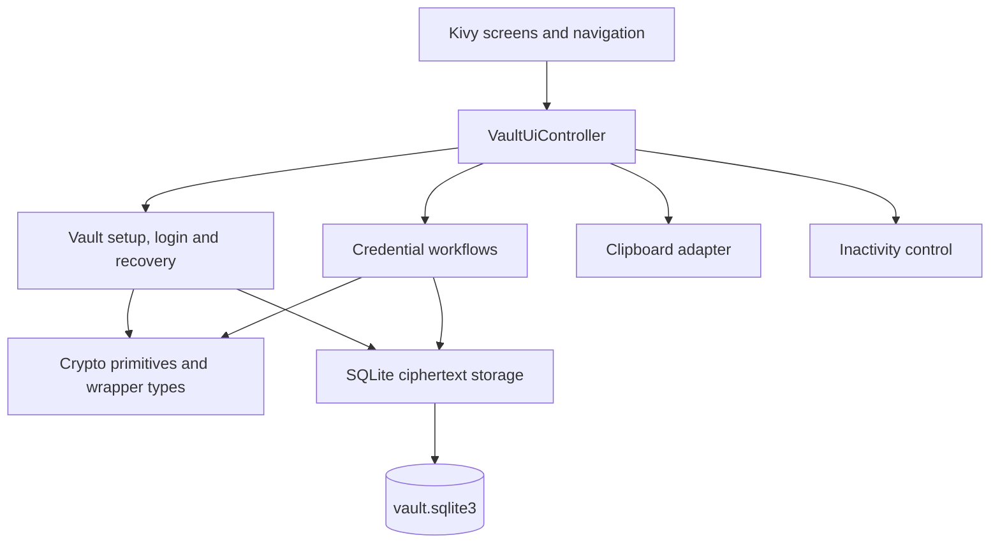

# Application Architecture and Module Boundaries

**Project:** Android Password Manager
**Related checklist tasks:** 2.2, 9.3
**Status:** Implemented architecture reconciled 2026-10-24; awaiting task approval.

## Architectural style

The application uses local layered components with presentation, workflow
coordination, security helpers, SQLite persistence and Android adapters.
This document describes the actual module layout. The diagram below groups
responsibilities; see [system diagrams](system-architecture.md) for runtime edges.

## Layer diagram



Platform adapters do not call storage. Serialization is in the credential
service, before encryption. App startup calls the secure-window adapter directly.

## Implemented module structure

```text
app/
├── main.py                 # Kivy application entry point
├── ui/                     # Screens, navigation, VaultUiController
├── services/               # Credentials, strength feedback, session timer
├── security/               # Vault workflow, models, KDF, keys, encryption
├── storage/                # SQLite connection, schema, repositories
├── platform/               # Clipboard, secure-window, and Android adapters
└── config.py               # Non-secret defaults
```

## Module responsibilities

### `main.py`

- Creates the Kivy application.
- Configures startup and screen navigation.
- Does not implement cryptography or direct SQL queries.

### `ui/`

- Renders approved screens and mockups.
- Collects user input and displays non-sensitive status messages.
- Sends actions to application services.
- Does not derive keys, encrypt data, or construct SQL statements.

### `services/`

- Contains credential validation/serialization, encrypted CRUD, in-memory search,
  strength feedback, and inactivity control.
- `ui/controller.py` owns active session/selection and coordinates workflows.
- `security/vault_service.py` handles setup/login/recovery; the generator is
  `security/password_generator.py`. These are not separate `services/` modules.
- Screens translate failures to generic user messages.

### Data models (no standalone `domain/` directory)

- `CredentialRecord` and `CredentialView` are in `services/credentials.py`.
- `VaultSetupResult` and `UnlockedVaultSession` are in `security/vault_service.py`.
- Payload, key and wrapper types are in their `security/` modules.
- Hidden passwords still exist in plaintext inside in-memory view objects.

### `security/`

- Generates keys and random values.
- Derives master and recovery key-encryption keys.
- Wraps and unwraps the vault-encryption key.
- Encrypts and decrypts vault records.
- Validates authentication tags and versioned security metadata.
- Must not import UI, platform adapters, or application navigation code.

### `storage/`

- Owns SQLite schema, connections, transactions, and repositories.
- Persists ciphertext, nonces, tags, salts, KDF parameters, and non-secret metadata.
- Receives encrypted payloads and wrapper metadata, not plaintext credentials.
- Must not implement key derivation or user-interface behavior.

### `platform/`

- Encapsulates clipboard access and clearing.
- Encapsulates Android secure-window behavior.
- Provides platform-aware timing or lifecycle hooks where needed.
- Keeps Android-specific calls out of security and domain modules.

### `config.py`

- Defines versioned, non-secret application settings.
- Does not contain passwords, recovery keys, vault files, signing keys, or machine-specific secrets.

## Dependency rules

```text
ui.screens → ui.controller → vault_service / credentials / session / platform
vault_service → wrapping / randomness / storage.sqlite
credentials → aead / vault session type / storage.sqlite
wrapping → kdf / aead / keys / randomness
storage.sqlite → security payload and wrapper types
platform.clipboard → session and credential view types / Kivy clipboard
main → controller / navigation / secure_window / Kivy timer and Window
```

- Low-level crypto helpers do not depend on UI state. The vault workflow lives
  in `security/` but depends on storage; this is not a fully independent domain layer.
- Storage code must not decide authentication or session policy.
- UI code must not access SQLite directly.
- No network client or remote service is part of phase one.
- Cross-layer calls should use explicit interfaces so unit tests can substitute fakes.

## Sensitive-data flow

1. UI collects a value and passes it to an application service.
2. The service validates the request and calls the security core.
3. The security core encrypts or derives only what is required.
4. Storage persists ciphertext and metadata.
5. The service returns a minimal success or failure result.
6. UI renders the result without receiving unnecessary key material.

## Session boundary

The application service owns whether the vault is locked or unlocked. A locked session must prevent credential operations. Auto-lock and manual lock must clear or invalidate active session references before returning to the login screen.

## Test boundary

Current test boundaries:

- UI tests validate navigation and user-visible behavior.
- Service tests use real crypto/SQLite (often in memory); clipboard/clock and
  Android objects are replaced with fakes where needed.
- Security tests validate cryptographic invariants and failure behavior.
- Storage tests validate schema, transactions, and ciphertext persistence.
- Local platform tests validate contracts with fakes. User-reported Android
  capture/recording and locking outcomes are separate evidence.

## UI and session lifecycle

Setup confirms recovery-key retention before normal navigation; login/recovery
create sessions; save/cancel returns to the vault. Scrollable form content and
dynamic text/control height support the keyboard and enlarged fonts. Android
uses pan mode. Entry-to-generator navigation preserves the draft for return.

One-second clipboard/inactivity checks run from `app.main`. Controller lock
drops active key/view references and invokes `clear_sensitive_screens()` on all
registered screens. This clears retained inputs/displays, including inactive
screens. The UI/timer routes back to login. Python/native buffers are not
guaranteed zeroized. No explicit Android pause/resume lock hook is implemented.

Refer to [technical documentation](../technical/TECHNICAL_DOCUMENTATION.md)
and [final test results](../testing/final-test-results.md) for current behavior
and verified limits. Architecture documentation does not constitute a security audit.

