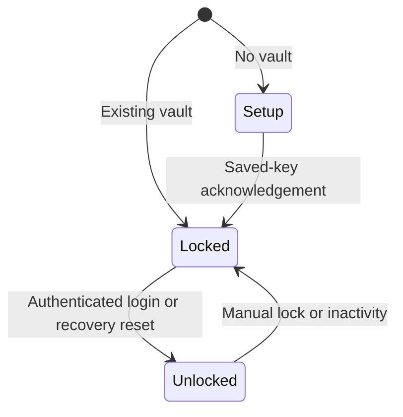

# Session and Platform Controls

**Project:** Android Password Manager
**Related checklist task:** 2.6
**Status:** Implementation-aligned 2026-10-24; see [security decisions](security-decisions.md).

## Session states

Setup creates the vault but does not establish an unlocked session. App/process
restart selects setup or locked according to whether a vault exists.

### Locked

- No vault-encryption key is available to application services.
- Credential operations are rejected or redirected to login.
- The login screen may display setup or recovery actions.
- App restart, process death, manual lock, and auto-lock result in this state.

### Unlocked

- The vault-encryption key is available only to the active session.
- Credential operations may proceed through application services.
- The inactivity timer is active.
- Sensitive screens use Android secure-window behavior.

## Login and unlock behavior

1. The app starts in `Locked` unless no vault exists and setup is required.
2. The user enters the master password.
3. The security service attempts to unwrap the vault-encryption key.
4. On success, the app creates an `Unlocked` session and starts activity tracking.
5. On failure, the app remains locked and displays a generic message.

Biometric unlock is not part of this state machine in phase one.

## Inactivity and automatic locking

- The inactivity limit is 120 seconds.
- The timer starts when the vault becomes unlocked.
- Implemented qualifying activity includes tracked input text changes, navigation
  and authenticated controller operations. Not every touch/scroll/selection event is tracked.
- Background execution or an inactive app window must not extend the active session.
- When 120 seconds elapse without qualifying activity, the app transitions to `Locked`.
- Explicit pause/resume hooks are not implemented; a one-second Kivy timer
  checks expiry while running. A >120-second background return passed on the
  test phone, without proving every lifecycle ordering/device safe.
- Manual lock transitions immediately to `Locked`.
- The timer must use a monotonic time source rather than wall-clock time.

## Lock transition actions

1. Stop or cancel the inactivity timer.
2. Invalidate the active session object.
3. Clear decrypted entry objects and temporary plaintext values where practical.
4. Clipboard expiry is checked separately by the app timer, not by lock itself.
5. Return to the login screen.
6. Prevent the prior session from performing further storage or credential operations.

The application must not claim that Python can guarantee immediate memory erasure from every runtime-managed object; this remains a documented residual risk.

## Clipboard behavior

- Copying requires an explicit user action.
- Only the selected password is copied; the app name and username are not copied automatically.
- The clipboard timeout is 30 seconds.
- The clipboard adapter should clear the value only if the clipboard still contains the value placed by this app, so it does not overwrite a newer user copy from another app.
- Copying and clearing must not be logged.
- The app must not automatically copy the recovery key.
- If the platform does not permit reliable comparison or clearing, the app must show a warning and record the limitation.

Actual UI permits explicit recovery-key copying during setup. Clearing is
best-effort and depends on the timer running. Keyboard-history retention was
observed; the user skipped its fix. App messages do not detect/confirm erasure
from keyboard history, and sensitive-clip metadata is not explicitly attached.
The manual documents this limitation rather than claiming history-wide clearing.

## Screenshot and screen-recording protection

- Enable Android secure-window behavior before displaying vault content, passwords, recovery keys, or authentication input.
- Keep the protection enabled for the entire application window in phase one unless testing demonstrates a safe narrower boundary.
- Sensitive content must not be rendered into a debug overlay or secondary window.
- The user manual must explain that secure-window flags do not stop external cameras or a fully compromised device.

## Android lifecycle behavior

| Event | Implemented behavior / evidence |
|---|---|
| App launch with existing vault | Start locked. |
| App launch without vault | Show setup flow without exposing credentials. |
| App sent to background | No explicit handler; background time is not qualifying activity. |
| App resumed before 120 seconds | No dedicated hook; device/session behavior not exhaustively tested. |
| App resumed after 120 seconds | Timer checks elapsed time; user reported login required without exposure on test phone. |
| Process killed | Require master-password login on next launch. |
| Orientation or configuration change | Preserve only safe session state; do not duplicate or expose plaintext unnecessarily. |
| Manual lock | Immediately clear or invalidate active session references. |

## Platform adapter boundary

The implemented `platform` layer exposes small interfaces for:

- Clipboard read/write/clear and timeout scheduling
- Secure-window configuration
- Monotonic clocks are injectable in session/clipboard services; no separate lifecycle adapter exists

Application code uses the clipboard interface and startup secure-window adapter.
Local tests inject clocks, clipboard and Android objects. Screen cleanup drops
widget-held values, with an entry/generator draft exception while unlocked.

## Verification requirements

- Unit test every session transition.
- Test locking at exactly and just beyond the 120-second boundary using an injectable clock.
- Test that activity resets the timer and background time does not.
- Test that clipboard timeout does not overwrite a newer clipboard value.
- Verify screenshot and screen-recording behavior on a physical Android device.
- Verify the app starts locked after process termination.

