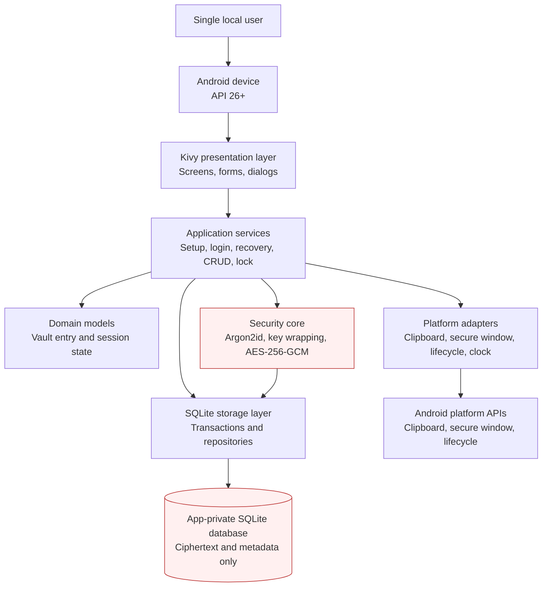
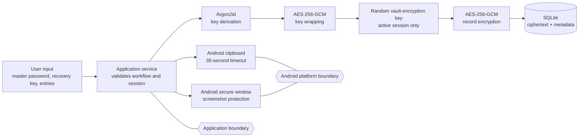

# System Architecture Diagram

**Project:** Android Password Manager
**Related checklist task:** 2.7
**Status:** Draft for review

## Architecture overview



## Data and trust boundaries



## Component responsibilities

| Component | Responsibility | Sensitive-data rule |
|---|---|---|
| Kivy presentation | Display approved screens and collect actions | Must not implement cryptography or direct SQL. |
| Application services | Coordinate workflows and session policy | Must return minimal UI-safe results. |
| Domain models | Represent entries and session state | Must not persist plaintext by themselves. |
| Security core | Derive keys, wrap keys, encrypt records, verify tags | Must not import UI code. |
| Storage layer | Persist ciphertext and metadata transactionally | Must never store plaintext credentials. |
| Platform adapters | Encapsulate clipboard, secure-window, clock, and lifecycle APIs | Must not log copied passwords or keys. |
| SQLite database | Store encrypted records and required metadata | Located in Android app-private storage. |

## Core data flow

1. The user supplies input through the Kivy interface.
2. An application service validates the requested workflow and session state.
3. The security core derives or unwraps keys as required.
4. Credential payloads are encrypted and authenticated before storage.
5. The storage layer commits ciphertext and metadata in a transaction.
6. The service returns a minimal result to the UI.
7. Locking invalidates the active session and returns the app to the login screen.

## Deployment boundary

```text
Python source
    │
    ▼
Kivy application
    │ Buildozer / python-for-android
    ▼
Private debug APK
    │
    ▼
Physical Android device
```

The phase-one application is local-only and requests no Internet permission. The public GitHub repository stores source and documentation, not vault data or secrets.

## References to detailed designs

- [Application architecture](application-architecture.md)
- [Vault-key architecture](vault-key-architecture.md)
- [Database schema](../database/schema.md)
- [Session and platform controls](session-and-platform-controls.md)
- [Threat model](threat-model.md)

