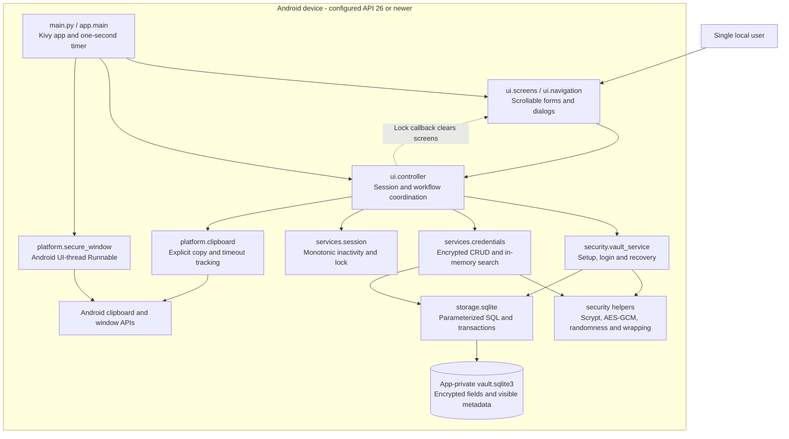
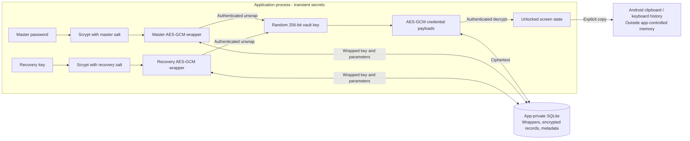

# System Architecture Diagram

**Project:** Android Password Manager
**Related checklist tasks:** 2.7, 9.3
**Status:** Reconciled with implemented source on 2026-10-24; awaiting task approval.

## Architecture overview



## Data and trust boundaries



## Component responsibilities

| Component | Responsibility | Sensitive-data rule |
|---|---|---|
| Kivy presentation | Display approved screens and collect actions | Must not implement cryptography or direct SQL. |
| UI controller and services | Coordinate workflows and session policy | Do not return raw key material to screens. Credential views may contain plaintext in memory. |
| Data models within services/security | Represent entries, payloads, wrappers and sessions | No standalone `domain/` package exists; models do not persist themselves. |
| Security core | Derive keys, wrap keys, encrypt records, verify tags | Must not import UI code. |
| Storage layer | Persist ciphertext and metadata transactionally | Must never store plaintext credentials. |
| Platform adapters | Clipboard and secure-window APIs; timing is in session/clipboard services | No explicit pause/resume adapter is implemented. |
| SQLite database | Store encrypted records and required metadata | Located in Android app-private storage. |

## Core data flow

1. The user supplies input through the Kivy interface.
2. An application service validates the requested workflow and session state.
3. The security core derives or unwraps keys as required.
4. Credential payloads are encrypted and authenticated before storage.
5. The storage layer commits ciphertext and metadata in a transaction.
6. The service returns a minimal result to the UI.
7. Controller locking invalidates the active key/view references and clears all
   screens through a callback. Manual UI actions or the app timer select login.

The diagram shows runtime calls/data flow, not a strict import graph. Storage
imports security payload/wrapper types; `security.vault_service` imports storage.
Screens receive plaintext credential values only in the unlocked workflow;
masking affects display and does not encrypt in-memory strings. Clipboard history
may retain copies after the app attempts its 30-second active-clipboard clearing.
FLAG_SECURE protects screen capture and does not protect clipboard contents.

## Deployment boundary

```text
Python source
    │
    ▼
Kivy application
    │ Buildozer / python-for-android
    ▼
Debug APK attached to a public GitHub Release
    │
    ▼
Physical Android device
```

The app itself is local-only and requests no Internet permission. Public GitHub
distribution was approved as a scope change. GitHub hosts code/documentation
and release APKs, never a hosted vault service. WSL Buildozer packages a separate
synced source copy; a rebuild and release upload are needed after source changes.
The published APK is not automatically identical to the current working tree.

## References to detailed designs

- [Application architecture](application-architecture.md)
- [Vault-key architecture](vault-key-architecture.md)
- [Database schema](../database/schema.md)
- [Session and platform controls](session-and-platform-controls.md)
- [Threat model](threat-model.md)

