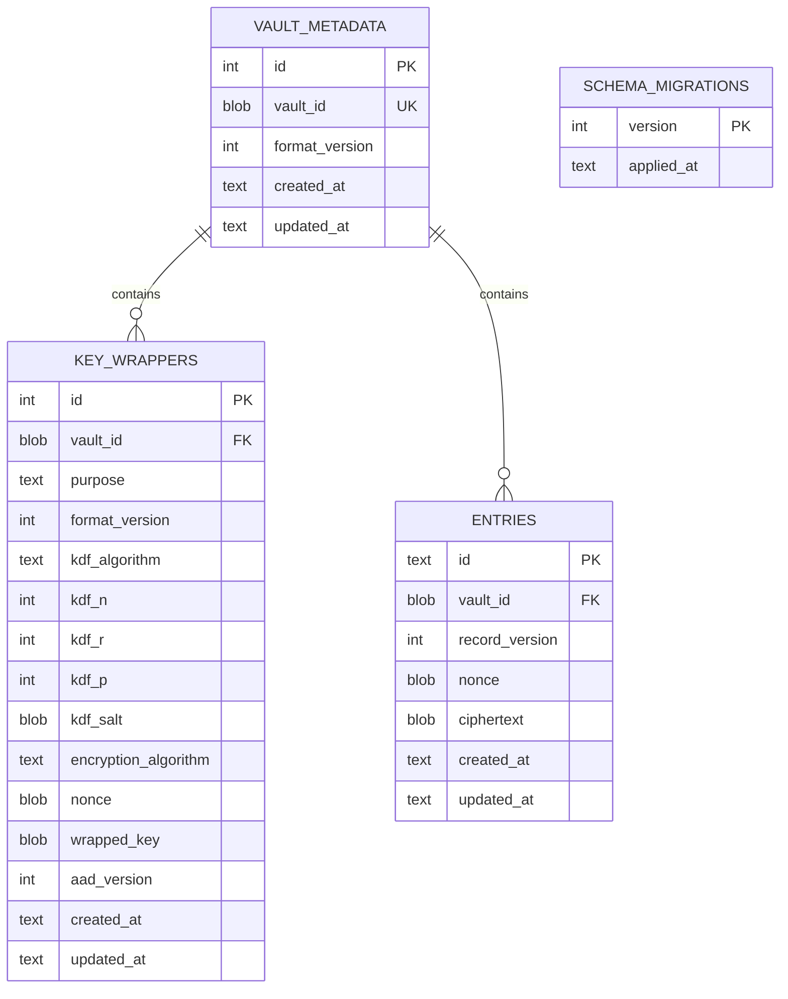

# Database Design Review

**Project:** Android Password Manager
**Related checklist tasks:** 2.8, 9.3
**Status:** Source reconciliation recorded 2026-10-24; awaiting task approval.

This review formalizes the database design described in [schema.md](schema.md) and confirms its alignment with the application architecture and vault-key design.

## Entity relationship overview

## Data classification

| Data | Database representation | Classification |
|---|---|---|
| Vault identifier | Random binary value | Non-secret identifier used in authenticated associated data. |
| KDF parameters and salts | Structured metadata | Non-secret; parameter validation and successful key derivation/authentication constrain accepted values. They are not all serialized directly into wrapper AAD. |
| Wrapped vault-encryption keys | Binary ciphertext and authentication tag | Critical secret material protected by master and recovery-derived keys. |
| App/website name | Inside encrypted entry payload | Sensitive; no plaintext search index. |
| Username | Inside encrypted entry payload | Sensitive. |
| Password | Inside encrypted entry payload | Critical. |
| Entry timestamps | Plaintext metadata | Limited metadata exposure accepted for ordering and maintenance. |
| Schema version | Plaintext metadata | Required for migration and validation. |

## Database invariants

1. There is at most one row in `vault_metadata`.
2. Every `key_wrappers` row belongs to the current vault.
3. There is exactly one active `master` wrapper and one active `recovery` wrapper after initialization.
4. Every entry belongs to the current vault.
5. Entry identifiers are unique and contain no app or website name.
6. Ciphertext, nonce, and wrapper fields are non-null.
7. Wrapper purposes are limited to `master` and `recovery`.
8. Future schema-ledger and unsupported crypto versions/algorithms are rejected;
   metadata-version validation is not universal across all read paths.
9. Foreign-key enforcement is enabled for every connection.
10. Normal queries return ciphertext and metadata; services decrypt in memory.

The ER diagram uses zero-or-more wrapper cardinality because that matches
SQLite's foreign-key constraint. Purpose/unique checks cap wrappers at two per
vault; exactly two is a service initialization invariant, not a foreign-key rule.
The migration ledger is independent and may exist before vault creation.

## Initialization transaction

The following operations must commit together:

1. Create the singleton vault metadata row.
2. Create the master key wrapper.
3. Create the recovery key wrapper.

If any operation fails, the transaction must roll back so the app does not leave an apparently initialized but unusable vault.

The initial schema/ledger is created earlier on opening the database and is not
part of this three-operation vault initialization transaction.

## Credential transaction rules

### Create

- Validate the entry in the application layer.
- Serialize and encrypt the payload with a fresh nonce.
- Insert the ciphertext and metadata in one transaction.

### Update

- Require an unlocked session.
- Encrypt the new payload with a fresh nonce.
- Replace ciphertext and update the timestamp atomically.

### Delete

- Require explicit user confirmation.
- Delete by entry identifier inside one transaction.
- Do not log the deleted plaintext or ciphertext.

## Recovery-reset transaction

1. Authenticate the recovery wrapper.
2. Derive a new master key-encryption key.
3. Update the existing master wrapper; fail if exactly one row was not updated.
4. Preserve the recovery wrapper.
5. Commit the wrapper update atomically.

The existing encrypted entries do not need to be rewritten because their vault-encryption key remains unchanged.

## Migration strategy

Implemented: version-2 table creation, initial ledger insertion when empty,
and rejection of a future highest ledger version. No complete numbered
migration runner exists. Same-version replacement was user-tested, not a
schema upgrade. Future migration work needs transactional transformations,
legacy fixtures, failure/rollback tests and explicit crypto-format compatibility.
Do not interpret the table name as evidence those transformations are implemented.

## Privacy decision: no plaintext search index

The database will not store an unencrypted app-name index in phase one. After unlock, the application may decrypt records in memory and perform search. This reduces metadata leakage at the cost of scanning a small local dataset.

## Backup and export boundary

The current phase-one database design does not include export or backup. Adding export requires a new design review covering file format, key protection, overwrite behavior, user confirmation, and recovery from corrupted or partial exports.

## Implementation review evidence

| Check | Observed evidence / limit |
|---|---|
| Foreign keys | PRAGMA enabled in VaultDatabase constructor |
| Initialization | Metadata and two wrappers inserted in one transaction; schema/ledger creation is earlier |
| Payload secrecy | Services encrypt before calling storage; local disk/column synthetic-secret checks pass |
| Nonces | Fresh random 12-byte values from encryption helper; uniqueness is probabilistic, not a SQL constraint |
| Context validation | Wrapper purpose/version/vault and record context are authenticated in supported paths |
| Logs/fixtures | Local captured-log checks pass; fixtures intentionally contain synthetic plaintext. Android log/full Git-history evidence is incomplete |
| Migrations | Startup schema/constraint tests exist; future-version rejection is implemented in source, but no dedicated future-version test was found. Numbered migration/rollback coverage is not claimed |

See [final test results](../testing/final-test-results.md) and
[technical guide](../technical/TECHNICAL_DOCUMENTATION.md). Root progress
checkboxes are controlled separately by user PASSKEY approval.

## Documentation verification (9.3)

Executed the SQL block from `schema.md` in a disposable in-memory SQLite
connection and compared normalized sqlite_master DDL with a fresh VaultDatabase.
All four table definitions, including types and constraints, matched; foreign
keys were enabled in both connections. No user database was modified.
This verifies documented schema correspondence, not migration/crash recovery.
Mermaid diagrams were source-reviewed; no rendered diagram export was produced
in this task.

