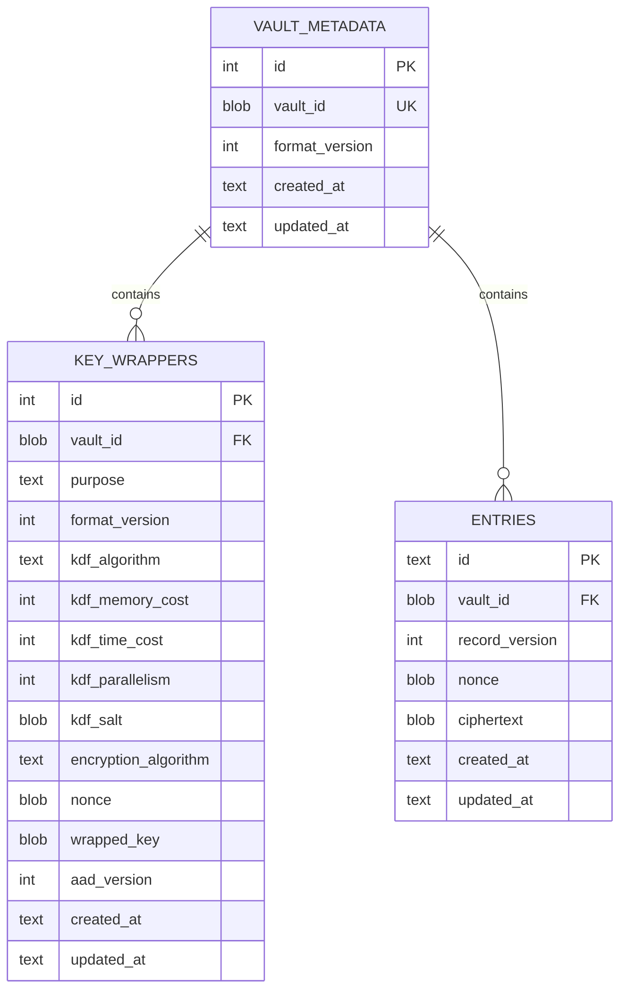

# Database Design Review

**Project:** Android Password Manager
**Related checklist task:** 2.8
**Status:** Draft for review

This review formalizes the database design described in [schema.md](schema.md) and confirms its alignment with the application architecture and vault-key design.

## Entity relationship overview

## Data classification

| Data | Database representation | Classification |
|---|---|---|
| Vault identifier | Random binary value | Non-secret identifier used in authenticated associated data. |
| KDF parameters and salts | Structured metadata | Non-secret but integrity-protected by the wrapper and schema validation. |
| Wrapped vault-encryption keys | Binary ciphertext and authentication tag | Critical secret material protected by master and recovery-derived keys. |
| App/website name | Inside encrypted entry payload | Sensitive; no plaintext search index. |
| Username | Inside encrypted entry payload | Sensitive. |
| Password | Inside encrypted entry payload | Critical. |
| Entry timestamps | Plaintext metadata | Limited metadata exposure accepted for ordering and maintenance. |
| Schema version | Plaintext metadata | Required for migration and validation. |

## Database invariants

1. There is at most one row in `vault_metadata`.
2. Every `key_wrappers` row belongs to the current vault.
3. There is exactly one active `master` wrapper and one active `recovery` wrapper after initialization.
4. Every entry belongs to the current vault.
5. Entry identifiers are unique and contain no app or website name.
6. Ciphertext, nonce, and wrapper fields are non-null.
7. Wrapper purposes are limited to `master` and `recovery`.
8. Unknown format or algorithm versions are rejected rather than guessed.
9. Foreign-key enforcement is enabled for every connection.
10. No database query may return plaintext credentials because plaintext is not stored in columns.

## Initialization transaction

The following operations must commit together:

1. Create the singleton vault metadata row.
2. Create the master key wrapper.
3. Create the recovery key wrapper.
4. Record the initial schema migration.

If any operation fails, the transaction must roll back so the app does not leave an apparently initialized but unusable vault.

## Credential transaction rules

### Create

- Validate the entry in the application layer.
- Serialize and encrypt the payload with a fresh nonce.
- Insert the ciphertext and metadata in one transaction.

### Update

- Require an unlocked session.
- Encrypt the new payload with a fresh nonce.
- Replace ciphertext and update the timestamp atomically.

### Delete

- Require explicit user confirmation.
- Delete by entry identifier inside one transaction.
- Do not log the deleted plaintext or ciphertext.

## Recovery-reset transaction

1. Authenticate the recovery wrapper.
2. Derive a new master key-encryption key.
3. Insert or replace the master wrapper.
4. Preserve the recovery wrapper.
5. Commit the wrapper update atomically.

The existing encrypted entries do not need to be rewritten because their vault-encryption key remains unchanged.

## Migration strategy

- Migrations are numbered and recorded in `schema_migrations`.
- A migration must be deterministic and idempotent or guarded by its version record.
- Migration code must not require plaintext credentials unless a format change explicitly requires authenticated decryption and re-encryption.
- A failed migration must roll back and leave the prior valid schema available.
- The app must refuse unsupported future schema versions rather than downgrade or guess.

## Privacy decision: no plaintext search index

The database will not store an unencrypted app-name index in phase one. After unlock, the application may decrypt records in memory and perform search. This reduces metadata leakage at the cost of scanning a small local dataset.

## Backup and export boundary

The current phase-one database design does not include export or backup. Adding export requires a new design review covering file format, key protection, overwrite behavior, user confirmation, and recovery from corrupted or partial exports.

## Implementation review checklist

- [ ] Schema is created with foreign keys enabled.
- [ ] Initialization is atomic.
- [ ] All credential payloads are encrypted before insertion.
- [ ] Nonces are generated per encryption operation.
- [ ] Wrapper purpose and format are authenticated and validated.
- [ ] No plaintext credentials appear in SQL queries, logs, or test fixtures.
- [ ] Migration tests cover clean, repeated, failed, and unsupported-version cases.

