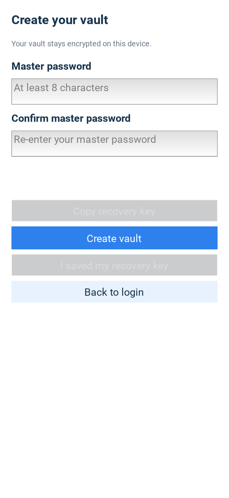
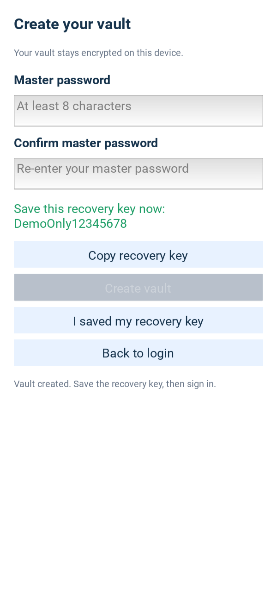
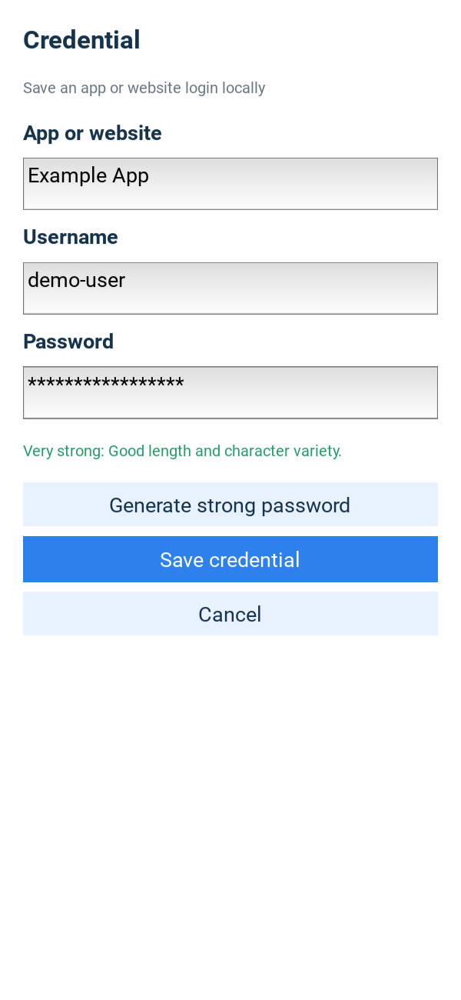
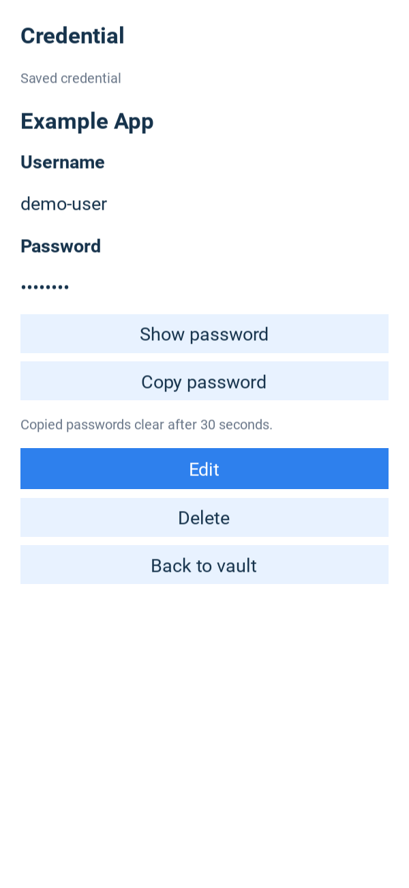
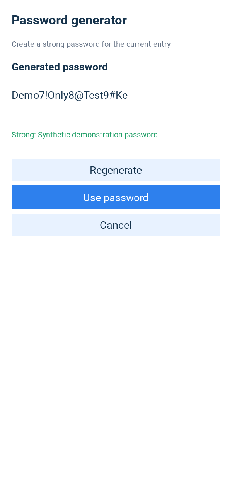
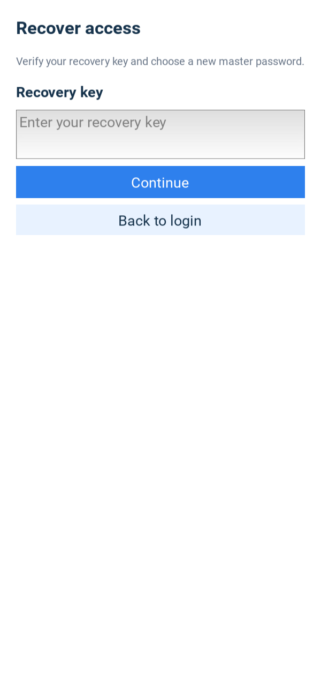
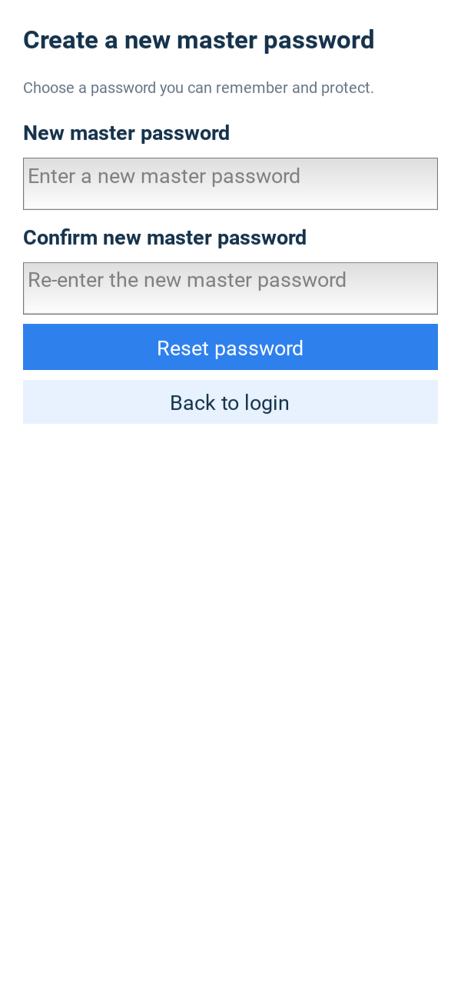

# Task 9.7 UI captures

Nine synthetic desktop Kivy captures, generated for task 9.7. These are not
Android phone screenshots. See the [evidence index](../SCREENSHOT_EVIDENCE.md)
for captions, staging details, dimensions and reproduction instructions.
They predate R-01's additional password-input Show/Hide controls and are
preserved as historical v0.1.0-era illustrations, not updated remediation evidence.

## Setup

## Recovery-key save confirmation

Public dummy key only; not a real recovery secret.

## Login

## Vault list

## Credential form

## Credential details

## Generator

Staged demonstration value/feedback, not an actual user's password.

## Recovery

## New master password

